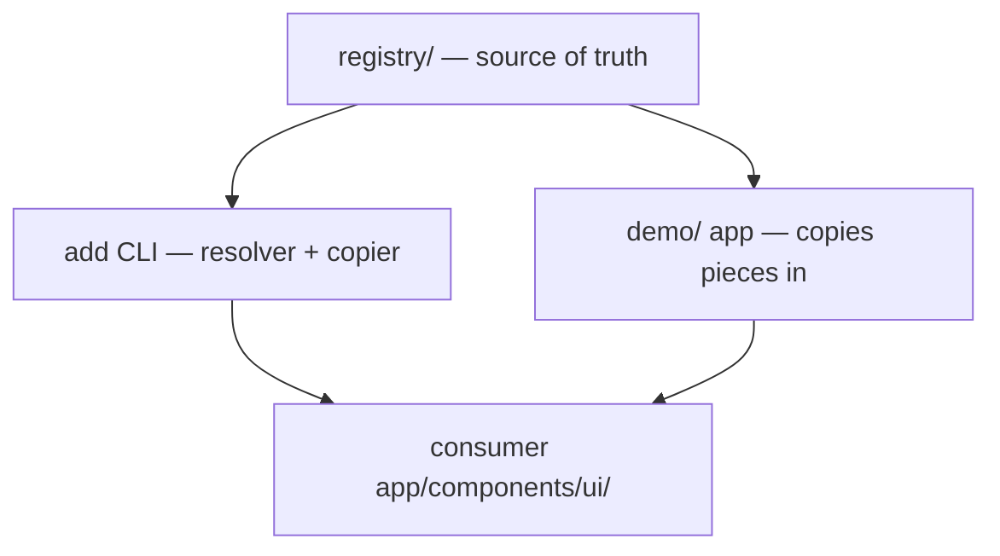

# Registry-to-consumer topology

The repo has one source of truth (`registry/`) and two downstream consumers: the in-repo demo app and any external Puzzle app that runs [[FEATURE-ADD-CLI]]. Pieces are copied source; an app imports the package only for the theme files and the appearance helper.

The demo is hand-synced from `registry/` (edit registry first, copy the file into `demo/app/components/ui/` — see CLAUDE.md topology rules). [[FEATURE-ADD-CLI]] does the same copy for external apps. Both paths are the copy-in model of [[DECISION-COPY-IN-DISTRIBUTION]]; the registry shape that makes the CLI a pure copier is [[DECISION-REGISTRY-SHAPED-REPO]].
