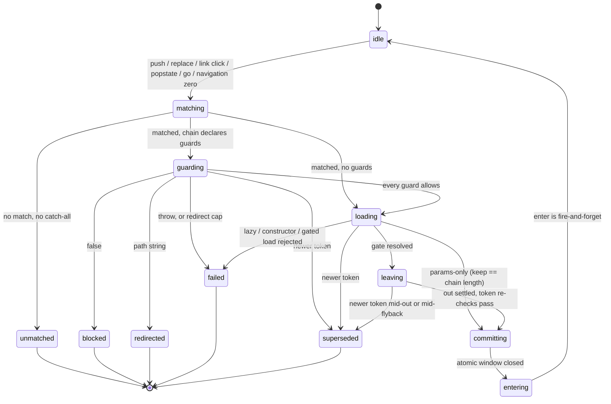

# Navigation state machine

One navigation attempt, request to commit, in `client-runtime/router/router.js`. The
machine is the same in every router mode (path, hash, memory): a mode owns only reading
the URL, writing it, and link interception. The step-by-step pipeline is
[[FLOW-NAVIGATION]]; the per-instance machine LOAD and COMMIT drive is
[[STATE-VIEW-LIFECYCLE]].

## The token is a navigation's identity

A monotonic token is claimed after the match, never before: bumping on an unmatched path
would doom a legitimate in-flight navigation. Every await is followed by a token re-check
and stale results are discarded. Last navigation wins; the loser cleans up only what it
built.

## The commit is atomic

`committing` is one synchronous block: URL and history entry (or memory stack),
`document.title`, the outgoing scroll save, the mounted tree, committed router state,
every prepared reused-ancestor refresh (params, snapshot, model, subscriptions), the
scroll landing, then focus and announcement. Rejected: committing the URL when loads
resolve and then animating (phantom history entries, URLs naming views that never
mounted), and rollback (racier than never committing).

## Terminal outcomes

`push()` and `replace()` resolve a never-rejecting `NavigationResult` (D182):
`{ ok: true, route, catchAll?, redirectedFrom? }` or
`{ ok: false, reason: 'blocked' | 'superseded' | 'not-found' | 'error', error? }`.

- **unmatched** → `not-found`. Nothing happened; no token, so an in-flight navigation is
  untouched.
- **blocked** → `blocked`. A guard returned `false`; nothing was constructed. A blocked pop
  repairs the address bar (the browser moved it before the guard ran). An entry guard that
  blocks navigation zero leaves the container empty and warns that it should redirect.
- **redirected** → the redirect's own result, plus `redirectedFrom`. The redirect inherits
  the denied verb (push mints its own entry; pop and navigation zero replace).
- **failed** → `error`. A guard throw, the redirect cap, or a pre-commit load failure:
  fresh instances dropped, prepared ancestors discarded, stalled leaver restored, error
  reported, a popped URL repaired with `replaceState`. This navigation owns the token, so
  it owns cleanup.
- **superseded** → `superseded`. A newer navigation owns the token. The loser must not
  touch shared state: it abandons its fresh instances and leaves the outgoing unit for the
  winner (tearing it down would rip it out from under a mid-flight morph).

## Gotchas

- Entry checks: a push to the committed path is a no-op only when nothing is in flight;
  with a navigation in flight it supersedes (and rewrites the committed entry rather than
  stacking a duplicate). A second push to the in-flight target returns the first push's
  promise, so `await router.push(p)` always means "p landed or failed". Guard redirects are
  exempt from the join, or a guard redirecting to its own path would await itself.
- A pop is asymmetric: the browser already moved the URL, so commit contributes only title
  (and memory index); every non-committing exit on a pop must restore the committed URL.
- `entering` isn't awaited, so the machine is idle when the commit window closes. A push or
  replace from a `mounted()` hook lands in that window: it is parked in one last-wins slot
  and re-dispatched afterwards, and its promise settles with that navigation.
- A skeleton view opts out of the LOAD gate, not the machine: its failure lands after
  commit, so the URL names a page showing its loading state. On prerender takeover at
  navigation zero the exemption is suppressed.
- Post-commit failures (render, `mounted()`) never re-enter this machine; they belong to
  [[STATE-VIEW-LIFECYCLE]]: the commit stands and only the failed position is replaced.
